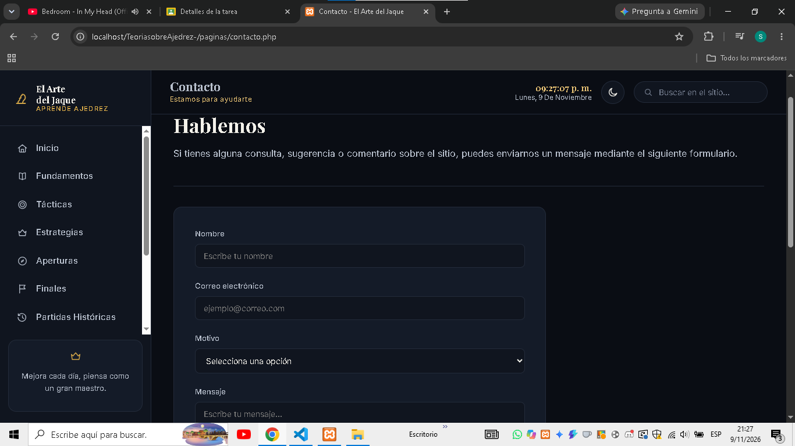
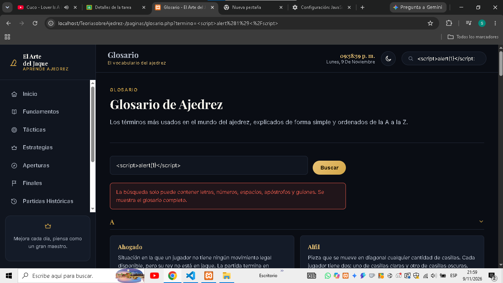

# El Arte del Jaque

Sitio educativo para aprender ajedrez desde cero: fundamentos, tácticas,
estrategias, aperturas, finales, partidas históricas, ejercicios, glosario y
recursos.

El proyecto empezó como una maqueta en HTML estático y se fue ampliando en
cada trabajo práctico de la materia:

| Trabajo práctico | Tema |
|---|---|
| [Trabajo Práctico 4](#trabajo-práctico-4--migración-a-php-ssi-y-ssr) | Migración a PHP, modularización (SSI) y renderizado server-side (SSR) |
| [Trabajo Práctico 5](#trabajo-práctico-5--formularios-y-seguridad-web) | Formularios POST y GET y seguridad web (XSS) |
| [Trabajo Práctico 6](#trabajo-práctico-6--base-de-datos-mysql) | Diseño y normalización de la base de datos MySQL |
| [Trabajo Práctico 7](#trabajo-práctico-7--crud-con-php-y-pdo) | Conexión con PDO y CRUD de ejercicios |
| [Trabajo Práctico 8](#trabajo-práctico-8--registro-login-y-roles) | Registro, login, sesiones y control de acceso por roles |

## Figma

[Ver prototipo en Figma](https://www.figma.com/proto/HnivPYR3kpvHwk225olJnL/Wireframing--Copia-?node-id=1156169-107&t=4nXvyhOtqRiE2W4T-1)

## Tecnologías utilizadas

- HTML5, CSS3 y JavaScript (sin frameworks)
- PHP 8.x con PDO
- MySQL / MariaDB
- XAMPP o Laragon como servidor local

> No se utilizó Bootstrap: todo el diseño es CSS propio (`css/style.css`).

## Instalación y ejecución local

1. Clonar o descargar el repositorio y copiar la carpeta dentro de `htdocs`
   (XAMPP) o `www` (Laragon), por ejemplo
   `C:\xampp\htdocs\TeoriasobreAjedrez-`.
2. Copiar `.env.example` como `.env`.
3. Iniciar **Apache** y **MySQL**.
4. En `http://localhost/phpmyadmin` → **Importar**, en este orden:
   1. `tp6/schema.sql` (crea la base `arte_del_jaque` y sus tablas)
   2. `tp6/consultas.sql` (roles, temas y usuarios)
   3. `tp7/datos_prueba.sql` (los 20 ejercicios del sitio)
   4. `tp8/usuarios_prueba.sql` (usuarios de prueba)
5. Abrir `http://localhost/TeoriasobreAjedrez-/index.php`.

Las páginas públicas funcionan sin la base de datos; la base hace falta para
los trabajos prácticos 7 y 8. La conexión usa `root` sin contraseña, como trae
XAMPP; si es otra, se cambia en `config/conexion.php`.

## Estructura del proyecto

```text
TeoriasobreAjedrez-/
├── index.php            Página de inicio
├── paginas/             Las demás páginas públicas del sitio
├── includes/            Partes comunes (header, nav, footer) y funciones
├── datos/               Contenido del sitio como arrays de PHP
├── css/ js/ img/        Estilos, scripts e imágenes
├── capturas/            Capturas de pantalla de este README
├── tp5/                 Trabajo Práctico 5: lógica de los formularios
├── tp6/                 Trabajo Práctico 6: normalización y scripts SQL
├── tp7/                 Trabajo Práctico 7: datos de prueba
├── tp8/                 Trabajo Práctico 8: usuarios de prueba y documentación
├── config/              Conexión PDO y configuración de la sesión
├── admin/               CRUD de ejercicios (Trabajo Práctico 7)
├── registro.php, login.php, logout.php, dashboard.php, admin_panel.php
│                        Cuentas de usuario (Trabajo Práctico 8)
├── .env.example         Plantilla de variables de entorno
└── README.md
```

---

## Trabajo Práctico 4 — Migración a PHP, SSI y SSR

Rama: `feature/migracion-php-ssi` · Pull Request #1

La maqueta HTML se migró a PHP: todas las páginas pasaron de `.html` a
`.php`, y las partes que se repetían se separaron en `includes/`.

### Modularización (SSI)

| Archivo | Contenido |
|---|---|
| `includes/header.php` | `<head>`, metadatos, título dinámico y hojas de estilo |
| `includes/nav.php` | Menú lateral y barra superior |
| `includes/footer.php` | Pie de página y scripts de JavaScript |

Cada página define sus variables y después incluye las plantillas:

```php
<?php
$titulo_pagina = "Aperturas - El Arte del Jaque";
$pagina_actual = "aperturas";
$ruta_base     = "../";      // "" en la raíz, "../" dentro de /paginas

require_once __DIR__ . '/../includes/header.php';
require_once __DIR__ . '/../includes/nav.php';
?>
<main> ... </main>
<?php require_once __DIR__ . '/../includes/footer.php'; ?>
```

### SSR

- **Título dinámico:** `header.php` imprime `<title>` con `$titulo_pagina`.
- **Menú activo:** `nav.php` compara `$pagina_actual` con cada enlace (función
  `nav_activo()`) y agrega la clase `active` desde el servidor.

### Variables de entorno

El archivo `.env` define `APP_NAME`, `APP_EMAIL` y `APP_ENV=local`.
`includes/config.php` lo lee y crea esas constantes (por ejemplo, el footer
usa `APP_NAME`). `.env` está en `.gitignore` y no se sube; `.env.example` sí,
como plantilla.

### Evidencias

- Sitio funcionando en `localhost`

  

- División en `header.php`, `nav.php` y `footer.php`

  
  
  

- Título de la pestaña distinto en cada página

  
  

- Clase `active` en el menú según la sección

  

- Archivo `.env.example` en el repositorio

  

---

## Trabajo Práctico 5 — Formularios y seguridad web

Rama: `feature/clase5-formularios-seguridad` · Pull Request #2

Procesamiento en el servidor de datos enviados por **POST** y **GET**, con
sanitización, validación y codificación de salida para prevenir
**Cross-Site Scripting (XSS)**. Los formularios están en páginas que ya
existían, y su lógica de PHP está en la carpeta `tp5/`:

| Archivo | Función |
|---|---|
| `tp5/seguridad.php` | `e()` (codificación de salida) y `limpiar()` (sanitización con `trim()`) |
| `tp5/procesar_contacto.php` | Captura, sanitiza y valida el formulario POST |
| `tp5/buscar_glosario.php` | Captura y valida el parámetro GET y hace la búsqueda |
| `tp5/datos/glosario.php` | Términos del glosario |

### Formulario POST — Contacto (`paginas/contacto.php`)

Se usa POST porque envía datos personales que no deben quedar en la URL ni en
el historial.

| Campo | Validación en PHP |
|---|---|
| `nombre` | Obligatorio, máximo 60 caracteres, solo letras, espacios, apóstrofos y guiones |
| `email` | Obligatorio, `FILTER_SANITIZE_EMAIL` y `FILTER_VALIDATE_EMAIL` |
| `motivo` | Obligatorio y dentro de una lista blanca |
| `mensaje` | Obligatorio, entre 10 y 500 caracteres |
| `aceptar` | La casilla tiene que estar marcada |

Con errores, se muestra un aviso general y el error de cada campo, y los
valores correctos se conservan. Sin errores, aparece un mensaje de éxito. El
mensaje no se envía por correo porque el trabajo no lo pide.

### Formulario GET — Buscador del glosario (`paginas/glosario.php`)

Se usa GET porque buscar no modifica nada y el resultado se puede guardar o
compartir: `glosario.php?termino=enroque`. El término se limpia y se valida (2
a 40 caracteres, solo letras, números, espacios, apóstrofos y guiones). La
búsqueda no distingue mayúsculas ni tildes, y las coincidencias se resaltan
con `<mark>`.

### Seguridad

- **Sanitizar** (limpiar el dato), **validar** (aceptarlo o rechazarlo) y
  **codificar la salida** (que el navegador no lo interprete como HTML) son
  pasos distintos y se aplican los tres.
- `filter_input()` lee `$_POST` y `$_GET`; con `FILTER_REQUIRE_SCALAR`
  rechaza arrays.
- Todo dato del usuario se imprime con `e()` = `htmlspecialchars($texto,
  ENT_QUOTES, 'UTF-8')`, también dentro de los `value="..."`.
- La validación definitiva la hace PHP: funciona aunque JavaScript esté
  desactivado.

**Ejemplo:** si se busca `<script>alert(1)</script>`, se muestra como texto y
no se ejecuta.

### Capturas

Las capturas de errores del formulario POST se tomaron con JavaScript
desactivado, para mostrar que valida PHP.

- Formulario POST vacío

  

- Envío exitoso

  

- Error de validación (formulario enviado vacío)

  

- Campos conservados después de un error (email inválido)

  

- Formulario GET enviado vacío

  

- Resultados de la búsqueda `?termino=peon`

  

- Búsqueda con `<script>alert(1)</script>`: no se ejecuta

  

---

## Trabajo Práctico 6 — Base de datos (MySQL)

Rama: `feature/tp6-base-de-datos` · Pull Request #4 · Carpeta [`tp6/`](tp6/)

Diseño de la base `arte_del_jaque`, que guarda los ejercicios del sitio.

| Archivo | Contenido |
|---|---|
| [`tp6/NORMALIZACION.md`](tp6/NORMALIZACION.md) | Tabla sin normalizar, pasos 1FN → 2FN → 3FN, tablas con PK/FK y diagrama entidad-relación |
| [`tp6/schema.sql`](tp6/schema.sql) | Creación de la base y de las 6 tablas |
| [`tp6/consultas.sql`](tp6/consultas.sql) | Datos de prueba y consultas CRUD (INSERT, SELECT con WHERE/ORDER BY, INNER JOIN, UPDATE y DELETE) |

**Tablas:** `roles` y `temas` (maestras), `usuarios`, `ejercicios` (principal),
`opciones_ejercicio` (detalle) e `intentos` (relación N:M entre usuarios y
ejercicios).

**Cómo probarlo:** en phpMyAdmin, importar `tp6/schema.sql` y después ejecutar
`tp6/consultas.sql` en la pestaña **SQL**. Volver a importar `schema.sql`
borra y crea las tablas de nuevo.

---

## Trabajo Práctico 7 — CRUD con PHP y PDO

Rama: `feature/tp7-crud-pdo` · Pull Request #5 · Panel en [`admin/`](admin/)

El sitio se conecta a la base del Trabajo Práctico 6 con **PDO** y tiene un
panel para listar, crear, editar y eliminar **ejercicios**, la tabla principal.
El tema (clave foránea a la tabla maestra `temas`) se elige con un `<select>`
cargado desde la base, y en el listado se muestra su nombre con `INNER JOIN`.

| Archivo | Qué hace |
|---|---|
| `config/conexion.php` | Conexión PDO (utf8mb4, excepciones, `FETCH_ASSOC`, consultas preparadas reales) |
| `admin/index.php` | **Read:** listado de ejercicios |
| `admin/crear.php` | **Create:** formulario de alta |
| `admin/editar.php` | **Update:** formulario de edición |
| `admin/eliminar.php` | **Delete:** baja por POST con confirmación |
| `includes/admin_ejercicios.php` | Consultas y validación del formulario |
| `tp7/datos_prueba.sql` | Los 20 ejercicios del sitio |

Después de cada operación, la página redirige al listado con
`?status=created|updated|deleted|error` y muestra el aviso (patrón PRG). Lo
que se carga en el panel se ve también en la página pública Ejercicios.

**Para probarlo:** importar la base (ver [Instalación](#instalación-y-ejecución-local))
y abrir `http://localhost/TeoriasobreAjedrez-/admin/` con un usuario
administrador (desde el Trabajo Práctico 8, el panel pide iniciar sesión).

### Seguridad

- **Excepciones de PDO:** todo está en `try/catch`; el detalle técnico va al
  log y el usuario ve un mensaje claro, sin errores de PHP.
- **Consultas preparadas:** toda consulta que recibe datos usa `prepare()`
  con marcadores (`:id`, `:enunciado`) y `execute()`. El SQL y los datos
  viajan por separado, así que un texto como `'); DROP TABLE ejercicios; --`
  se guarda como texto y no se ejecuta.
- **XSS:** todo lo que se imprime pasa por `htmlspecialchars()` (función
  `e()`), incluidos los `value` de los inputs y los id de los enlaces.
- **Validación en el servidor:** campos obligatorios, tipos y largos máximos
  del esquema; si algo falla, el formulario vuelve con los errores y los datos.
- **id validado** con `filter_input(..., FILTER_VALIDATE_INT)` y comprobando
  que exista.
- **Eliminar solo por POST** y con un mensaje claro si una clave foránea
  impide el borrado.

---

## Trabajo Práctico 8 — Registro, login y roles

Rama: `feature/tp8-autenticacion` · Pull Request #6 ·
**Documentación completa en [`tp8/README.md`](tp8/README.md)**

Registro, inicio y cierre de sesión, sesión segura y control de acceso por
roles: `dashboard.php` es para cualquier usuario con sesión, y
`admin_panel.php` y el CRUD de `admin/` son solo para el administrador.

Usuarios de prueba: `admin@demo.com` / `Admin1234` (admin) y
`usuario@demo.com` / `Usuario1234` (usuario).

---

## Registro de cambios

Mejoras hechas fuera de los trabajos prácticos. Se integraron con el Pull
Request #3.

- **Fase 1 — Correcciones visuales:** se arreglaron bloques con imágenes rotas
  y tarjetas vacías, y se corrigieron textos desactualizados.
- **Fase 2 — Navegación:** Contacto en el menú, enlaces "Anterior / Siguiente"
  entre secciones y todo el sitio escrito en "tú".
- **Fase 3 — Orden del código:** lista única de secciones
  (`datos/secciones.php`) que genera el menú, y CSS con índice.
- **Fase 4 — Aperturas:** catálogo de 28 aperturas con filtro por tipo (GET) y
  8 trampas de apertura.
- **Fase 5 — Contenido:** ejemplos en Tácticas, patrones de mate, mates
  básicos y finales teóricos, estructuras de peones, notación, ritmos y reglas
  de torneo, y glosario de 63 términos.
- **Fase 6 — Ejercicios interactivos:** 20 ejercicios con respuesta al hacer
  clic y diagramas de tablero.
- **Fase 7 — Ajustes finales:** imágenes guardadas en `img/` y botón "volver
  arriba".
- **Ajustes de diseño:** carruseles con flechas (piezas, reglas, partidas y
  ejercicios), fichas con diagramas para las 6 piezas y revisión del modo
  claro.

## Créditos

Sitio educativo creado por **Samuel**.
