# El Arte del Jaque

Sitio educativo dedicado a enseñar ajedrez desde cero: fundamentos, tácticas,
estrategias, aperturas, finales, partidas históricas, ejercicios, glosario y
recursos para seguir aprendiendo.

Este proyecto fue **migrado de HTML estático a PHP**, aplicando
**modularización mediante includes (SSI)** y **renderizado server-side (SSR)**
para el título de cada página y el resaltado del menú activo, en el marco del
**Trabajo Práctico N° 4** de la materia.

## Figma

Enlace al prototipo de Figma: 
[Ver prototipo en Figma](https://www.figma.com/proto/HnivPYR3kpvHwk225olJnL/Wireframing--Copia-?node-id=1156169-107&t=4nXvyhOtqRiE2W4T-1)

## Tecnologías utilizadas

- HTML5
- CSS3
- JavaScript (vanilla, sin frameworks)
- PHP 8.x
- Google Fonts (Playfair Display / Inter)
- XAMPP o Laragon (servidor local para ejecutar PHP)

> No se utilizó Bootstrap ni ningún otro framework de CSS: todo el diseño es
> CSS propio (`css/style.css`).

## Estructura del proyecto

```text
TeoriasobreAjedrez-/
├── datos/                Contenido del sitio como arrays de PHP
│   ├── secciones.php     Lista única de secciones: genera el menú, el paginador
│   │                     y las tarjetas de "Sobre el sitio"
│   ├── aperturas.php     Catálogo de 28 aperturas (fichas)
│   ├── tipos-apertura.php Tipos de apertura (lista blanca del filtro GET)
│   ├── trampas.php       Trampas de apertura
│   └── ejercicios.php    Ejercicios interactivos, con posiciones FEN
├── clase5/               Clase 5: procesamiento de formularios y seguridad
│   ├── seguridad.php         e() (htmlspecialchars) y limpiar() (trim)
│   ├── procesar_contacto.php Lógica del formulario POST (contacto)
│   ├── buscar_glosario.php   Lógica del formulario GET (buscador del glosario)
│   └── datos/
│       └── glosario.php      Términos del glosario como array de PHP
├── includes/
│   ├── config.php        Carga de variables de entorno (.env) y constantes
│   ├── header.php        DOCTYPE, <head>, meta tags, título dinámico
│   ├── nav.php           Sidebar de navegación + barra superior (SSR: menú activo)
│   ├── secciones.php     Funciones secciones_del_sitio() y url_seccion()
│   ├── componentes.php   ficha_apertura(), tarjeta_trampa(), ejercicio() y tablero()
│   ├── paginacion.php    Enlaces "Anterior / Siguiente" entre secciones
│   └── footer.php        Footer, script común y cierre de body/html
├── css/
│   └── style.css
├── js/
│   └── main.js
├── paginas/
│   ├── aperturas.php
│   ├── contacto.php      Formulario de contacto (POST) — Clase 5
│   ├── ejercicios.php
│   ├── estrategias.php
│   ├── finales.php
│   ├── fundamentos.php
│   ├── glosario.php      Glosario + buscador (GET) — Clase 5
│   ├── partidas.php
│   ├── plan-de-estudio.php Recorrido por niveles que enlaza a las secciones
│   ├── recursos.php
│   ├── sobre-el-sitio.php
│   └── tacticas.php
├── capturas/
│   ├── localhost.png
│   ├── header-php.png
│   ├── nav-php.png
│   ├── footer-php.png
│   ├── titulo-dinamico-uno.png
│   ├── titulo-dinamico-dos.png
│   ├── Menu-Activo.png
│   └── env-example.png
├── index.php
├── robots.txt
├── sitemap.xml
├── .env                  Variables de entorno locales (NO se sube a Git)
├── .env.example          Plantilla pública de variables de entorno
├── .gitignore
└── README.md
```

## Modularización (SSI) y SSR

Cada página PHP define, antes de incluir las plantillas comunes, las
variables que necesita el sitio para renderizarse correctamente:

```php
<?php
$titulo_pagina    = "Aperturas - El Arte del Jaque";
$meta_descripcion = "Descubre las aperturas del ajedrez...";
$pagina_actual    = "aperturas";
$header_titulo    = "Aperturas";
$header_tagline   = "El comienzo de toda partida";
$ruta_base        = "../";      // "" en la raíz, "../" dentro de /paginas
$ruta_paginas     = "";         // "paginas/" en la raíz, "" dentro de /paginas
$es_home          = false;

require_once __DIR__ . '/../includes/header.php';
require_once __DIR__ . '/../includes/nav.php';
?>

<main>
    <!-- contenido específico de la página -->
</main>

<?php require_once __DIR__ . '/../includes/footer.php'; ?>
```

- **Título dinámico:** `header.php` imprime `<title><?= $titulo_pagina ?></title>`.
- **Menú activo:** `nav.php` compara `$pagina_actual` contra el slug de cada
  enlace del sidebar mediante la función `nav_activo()` y agrega la clase
  `active` en el servidor (además, `js/main.js` sigue reforzando el resaltado
  en el cliente comparando la URL, tal como ya lo hacía el proyecto original).
- **Rutas relativas:** `$ruta_base` y `$ruta_paginas` resuelven las rutas de
  CSS, JS, imágenes e includes según la profundidad del archivo (raíz vs.
  `/paginas`), evitando enlaces rotos.

## Clase 5 — Procesamiento de Formularios y Seguridad Web

Rama: `feature/clase5-formularios-seguridad`

### 1. Descripción general

**Objetivo:** procesar en el servidor, con PHP, información enviada desde el
navegador mediante los métodos HTTP **POST** y **GET**, aplicando
sanitización, validación y codificación de salida para prevenir ataques
**Cross-Site Scripting (XSS)**.

**Funcionalidades incorporadas:**

- **Formulario POST** de contacto, con validación en el servidor, mensajes de
  error por campo, mensaje de éxito y conservación de los datos ante errores.
- **Formulario GET** de búsqueda en el glosario de ajedrez, con resultados
  reales, coincidencias resaltadas y mensajes para búsquedas vacías,
  incorrectas o sin resultados.

**Organización:** los formularios están en las páginas que ya existían
(`contacto.php` y `glosario.php`) para mantener el diseño y la navegación. La
lógica de PHP de la Clase 5 está separada en la carpeta `clase5/`, y cada
página la incluye con `require_once` antes de imprimir el HTML:

| Archivo | Función |
| --- | --- |
| `clase5/seguridad.php` | Funciones `e()` (codificación de salida) y `limpiar()` (sanitización con `trim()`) |
| `clase5/procesar_contacto.php` | Captura, sanitiza y valida el formulario POST |
| `clase5/buscar_glosario.php` | Captura, sanitiza y valida el parámetro GET y realiza la búsqueda |
| `clase5/datos/glosario.php` | Los términos del glosario como array de PHP (38 en la entrega; 63 desde la Fase 5) |

No se usa base de datos ni librerías externas: solo funciones nativas de PHP.

### 2. Formulario POST

- **Ubicación:** página **Contacto** (`paginas/contacto.php`), enlazada desde el
  footer de todas las páginas.
- **Finalidad:** que los visitantes envíen consultas, sugerencias o reportes de
  errores sobre el sitio.
- **Por qué POST:** el formulario envía datos personales (nombre, correo,
  mensaje), que no deben quedar visibles en la URL, en el historial ni en los
  favoritos.
- **Datos recibidos** (`$_POST`, leídos con `filter_input(INPUT_POST, ...)`):

  | Campo | Validación en PHP |
  | --- | --- |
  | `nombre` | Obligatorio, máximo 60 caracteres, solo letras, espacios, apóstrofos y guiones |
  | `email` | Obligatorio, sin caracteres prohibidos (`FILTER_SANITIZE_EMAIL`) y con formato válido (`FILTER_VALIDATE_EMAIL`) |
  | `motivo` | Obligatorio y dentro de una lista blanca (`consulta`, `sugerencia`, `error`, `otro`) |
  | `mensaje` | Obligatorio, entre 10 y 500 caracteres |
  | `aceptar` | La casilla tiene que estar marcada (`isset()`) |

- **Respuesta:**
  - Con errores: aviso general en rojo y, debajo de cada campo, el error
    concreto. Los valores correctos **se conservan** en el formulario.
  - Sin errores: mensaje de éxito con el nombre y el motivo, y el formulario
    queda vacío.
- **Seguridad:** sanitización con `trim()`, validación completa en PHP (no
  depende de `required`, `type="email"` ni de JavaScript) y todo dato del
  usuario se imprime con `htmlspecialchars()` (función `e()`), tanto en los
  mensajes como dentro de los `value="..."` y del `<textarea>`.
- **Nota:** el mensaje no se envía por correo ni se guarda, porque el TP no lo
  exige. El punto donde se haría está marcado en `procesar_contacto.php`.

### 3. Formulario GET

- **Ubicación:** página **Glosario** (`paginas/glosario.php`), arriba de la
  lista de términos. La caja "Buscar en el glosario..." del encabezado (visible
  en pantallas grandes) usa el mismo parámetro y lleva a esta página desde
  cualquier sección del sitio.
- **Finalidad:** encontrar rápidamente un concepto de ajedrez entre los términos
  del glosario (38 en la entrega del TP; 63 desde la Fase 5).
- **Por qué GET:** buscar no modifica nada en el servidor. Al quedar en la URL,
  el resultado se puede recargar, guardar en favoritos o compartir.
- **Parámetro:** `termino` → por ejemplo `paginas/glosario.php?termino=enroque`.
- **Funcionamiento:**
  1. Se lee `termino` con `filter_input(INPUT_GET, ...)` y se limpia con `trim()`.
  2. Se valida: no vacío, de 2 a 40 caracteres y solo letras, números,
     espacios, apóstrofos y guiones.
  3. Se recorre el array del glosario y se muestran los términos cuyo nombre o
     definición contienen la palabra, sin distinguir mayúsculas ni tildes
     (`tactica` encuentra "Táctica").
  4. Las coincidencias se resaltan con `<mark>`, y se muestra la cantidad de
     resultados con un enlace para volver al glosario completo.
- **Respuesta:**
  - Sin búsqueda: el glosario completo, igual que antes (por letra, con acordeón).
  - Búsqueda vacía o con caracteres no permitidos: aviso en rojo y el glosario completo.
  - Sin coincidencias: aviso informativo.
- **Tratamiento de los datos:** el término buscado **queda cargado** en el campo
  y aparece en los mensajes, siempre codificado con `htmlspecialchars()`. El
  resaltado se arma codificando cada parte del texto por separado, así el
  `<mark>` lo agrega el sitio y ningún texto llega al HTML sin pasar por `e()`.

### 4. Seguridad

Se distinguen tres pasos que **no se reemplazan entre sí**:

- **Sanitizar** es limpiar o normalizar el dato que llega (por ejemplo, quitar espacios).
- **Validar** es decidir si el dato es aceptable; si no lo es, se rechaza con un mensaje.
- **Codificar la salida** es convertir los caracteres especiales al mostrar el
  dato, para que el navegador no los interprete como HTML o JavaScript.

| Función | Cómo se usó |
| --- | --- |
| `trim()` | En `limpiar()`: quita los espacios del principio y del final. Un campo con solo espacios queda vacío y la validación lo rechaza. |
| `isset()` | Comprueba si llegó el parámetro `termino` (¿hubo búsqueda?), si la casilla `aceptar` fue enviada y si la petición es POST. |
| `empty()` | Detecta los campos obligatorios vacíos, después del `trim()`. |
| `filter_input()` | Lee `$_POST` y `$_GET` de forma controlada: devuelve `null` si el campo no existe y, con `FILTER_REQUIRE_SCALAR`, rechaza arrays (`?termino[]=x`). |
| `filter_var()` + `FILTER_SANITIZE_EMAIL` | **Sanitización**: si al quitar los caracteres prohibidos el email cambia, se avisa al usuario en lugar de corregirlo en silencio. |
| `filter_var()` + `FILTER_VALIDATE_EMAIL` | **Validación**: comprueba que el correo tenga formato `usuario@dominio.ext`. |
| `htmlspecialchars($texto, ENT_QUOTES, 'UTF-8')` | En `e()`: toda salida con datos del usuario. `ENT_QUOTES` codifica también las comillas, así el dato no puede cerrar un atributo `value="..."`. |

**Ejemplo de XSS bloqueado:** si se busca `<script>alert(1)</script>`, la
validación lo rechaza y el texto vuelve al campo como
`&lt;script&gt;alert(1)&lt;/script&gt;`: se ve como texto y no se ejecuta.

La validación de `js/main.js` sigue funcionando como ayuda visual, pero las
comprobaciones definitivas las hace PHP.

### 5. Capturas de pantalla

Capturas tomadas con el sitio corriendo en XAMPP (`localhost`). Las capturas
de errores del formulario POST se tomaron con **JavaScript desactivado** en el
navegador, para demostrar que la validación la realiza PHP en el servidor.

- [x] **Formulario POST:** página Contacto vacía.

  

- [x] **Envío exitoso:** PHP valida los datos, muestra "¡Gracias, …!" con el
  nombre y el motivo, y vacía el formulario.

  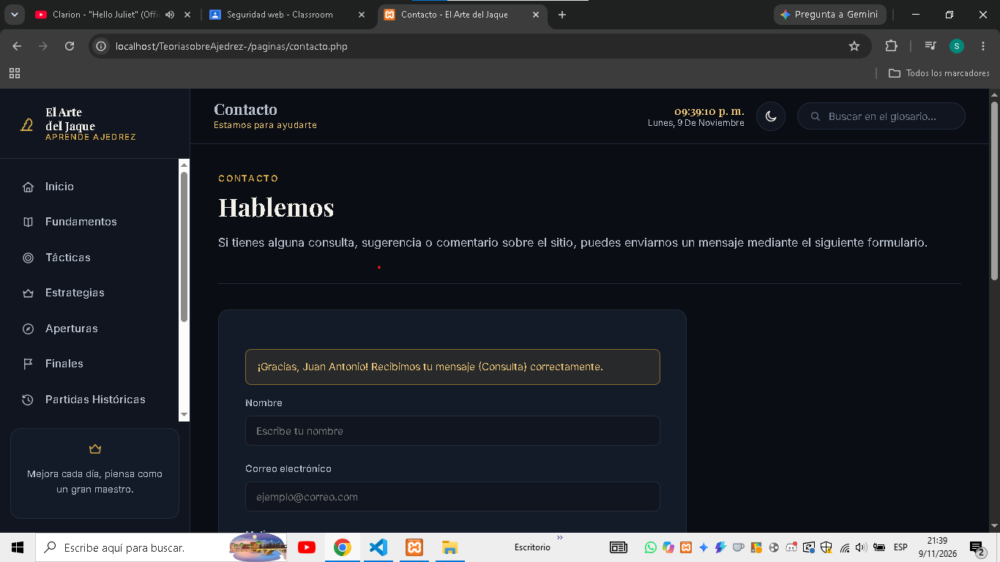

- [x] **Error de validación:** formulario enviado vacío. Aparece el aviso
  general y el error de cada campo obligatorio.

  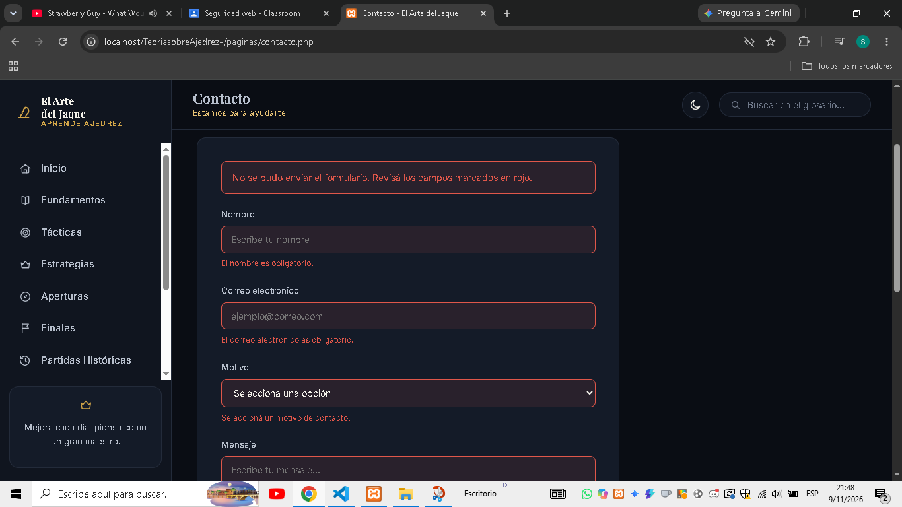

- [x] **Campos conservados después de un error:** el email `ana@correo` es
  inválido, pero el nombre, el motivo y el mensaje siguen cargados.

  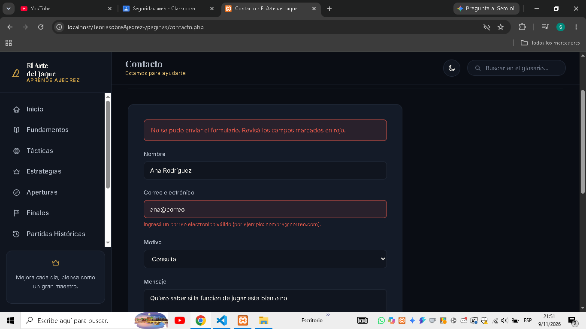

- [x] **Formulario GET:** buscador del glosario enviado vacío
  (`?termino=`). PHP avisa que falta la palabra y muestra el glosario completo.

  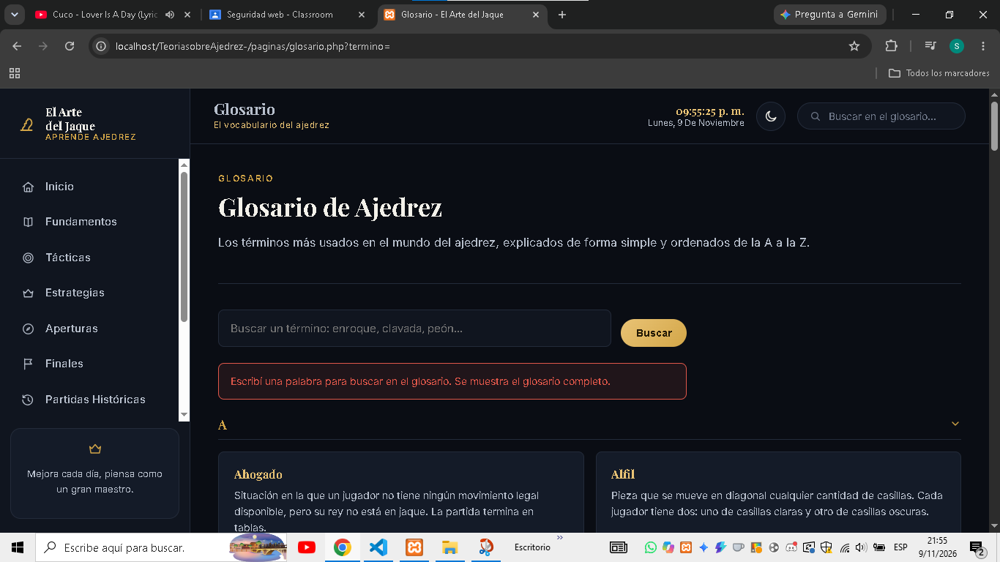

- [x] **Resultados de búsqueda:** `?termino=peon` encuentra 12 términos (sin
  importar la tilde de "peón") y resalta las coincidencias.

  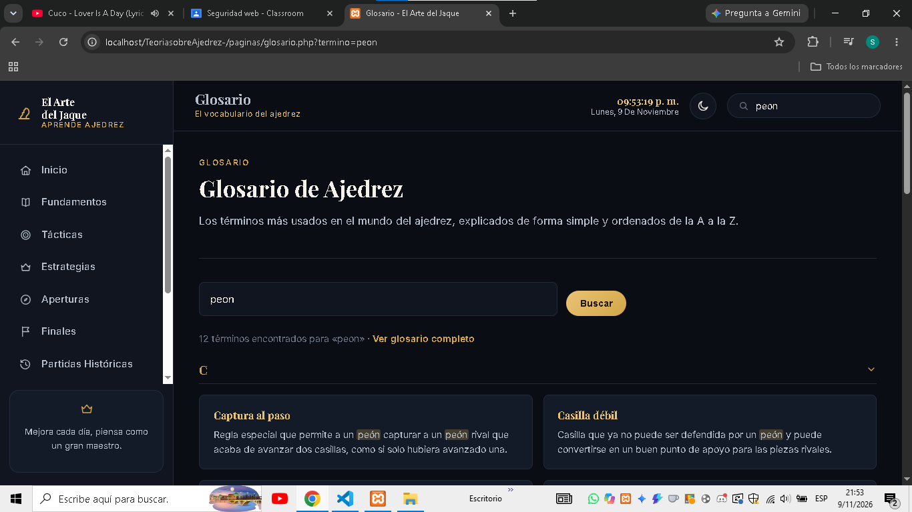

- [x] **Entrada con caracteres especiales:** al buscar
  `<script>alert(1)</script>` **no se ejecuta ninguna alerta**, aunque
  JavaScript está activado. El texto se muestra tal cual en el campo y PHP
  rechaza la búsqueda por contener caracteres no permitidos.

  

## Variables de entorno

El archivo `.env` (en la raíz del proyecto) define:

```env
APP_NAME=El Arte del Jaque
APP_EMAIL=contacto@el-arte-del-jaque.com
APP_ENV=local
```

`includes/config.php` lee este archivo con un parser simple (sin librerías
externas, ya que el nivel del TP no lo requiere) y expone las constantes
`APP_NAME`, `APP_EMAIL` y `APP_ENV` para usarlas en cualquier página
(por ejemplo, el copyright del footer usa `APP_NAME`).

- `.env` **no se sube a GitHub** (está en `.gitignore`).
- `.env.example` sí se sube, como plantilla sin datos sensibles.

## Instalación y ejecución local

### Con XAMPP

1. Clonar (o descargar) este repositorio.
2. Copiar la carpeta del proyecto (`TeoriasobreAjedrez-`) dentro de `htdocs`
   de tu instalación de XAMPP: `C:\xampp\htdocs\TeoriasobreAjedrez-`.
3. Copiar `.env.example` como `.env` (si no existe ya) y ajustar los valores
   si hace falta.
4. Iniciar el módulo **Apache** desde el panel de control de XAMPP.
5. Abrir el navegador en:
   ```
   http://localhost/TeoriasobreAjedrez-/index.php
   ```

> Si la carpeta tiene otro nombre dentro de `htdocs`, la dirección cambia en
> la misma forma: `http://localhost/<nombre-de-la-carpeta>/index.php`.

### Con Laragon

1. Clonar (o descargar) este repositorio dentro de la carpeta `www` de Laragon.
2. Copiar `.env.example` como `.env`.
3. Iniciar Laragon (Apache + PHP).
4. Abrir el navegador en:
   ```
   http://localhost/TeoriasobreAjedrez-/index.php
   ```
   o usar el dominio virtual que genera Laragon automáticamente.

## Rama y commits (Git)

Este trabajo corresponde a la rama:

```text
feature/migracion-php-ssi
```

```text
chore: eliminar copia duplicada del proyecto
feat: migrar paginas HTML a PHP
feat: agregar estructura SSI
feat: integrar SSI y renderizado SSR en las paginas
chore: configurar variables de entorno
fix: actualizar referencias de HTML a PHP
docs: actualizar README para TP4
```

> [TODO: crear la rama, realizar los commits y el Pull Request desde tu
> entorno de Git local/GitHub — esto no pudo automatizarse porque el
> proyecto fue procesado fuera de un repositorio Git.]

## Evidencias

- [x] Sitio funcionando en `localhost` (página de inicio)
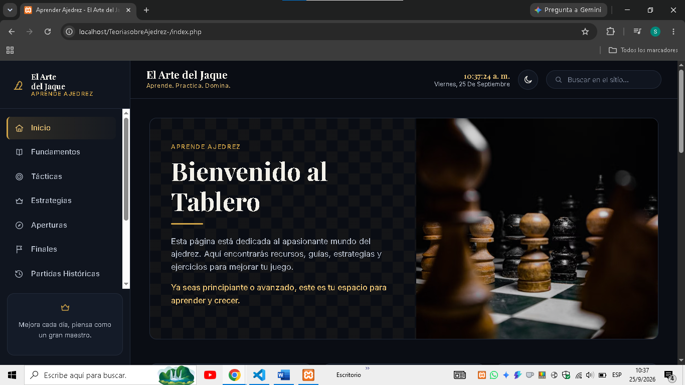
- [x] Contenido de `includes/header.php`
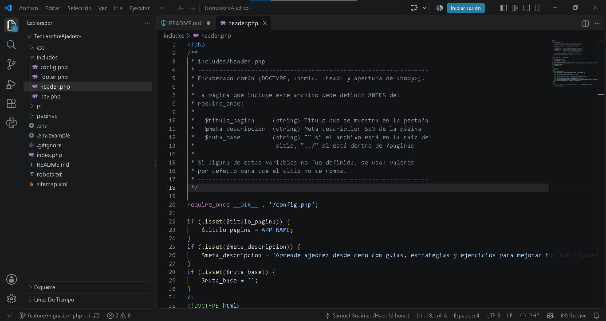
- [x] Contenido de `includes/nav.php`
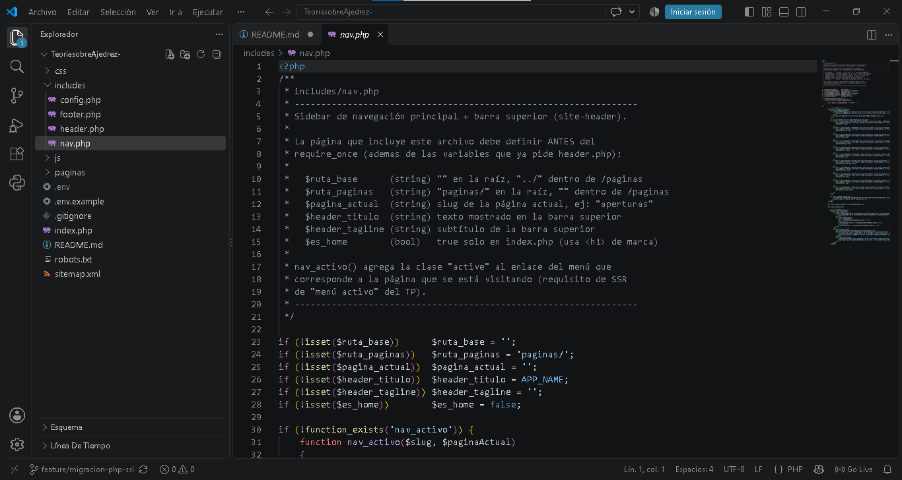
- [x] Contenido de `includes/footer.php`
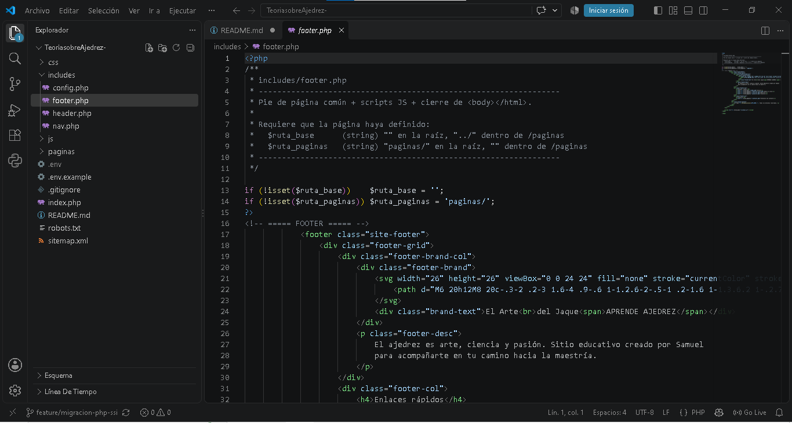
- [x] Título dinámico visible en la pestaña del navegador (dos páginas distintas)
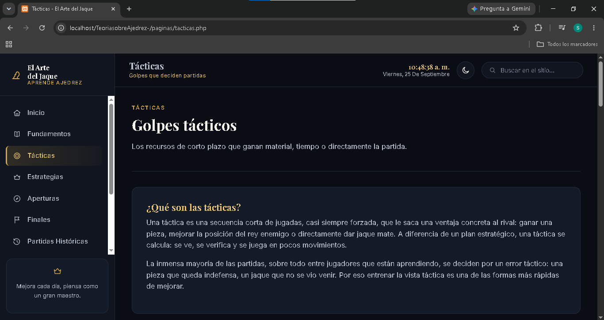
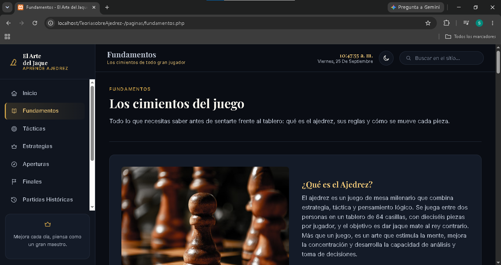
- [x] Menú activo resaltando la sección correspondiente
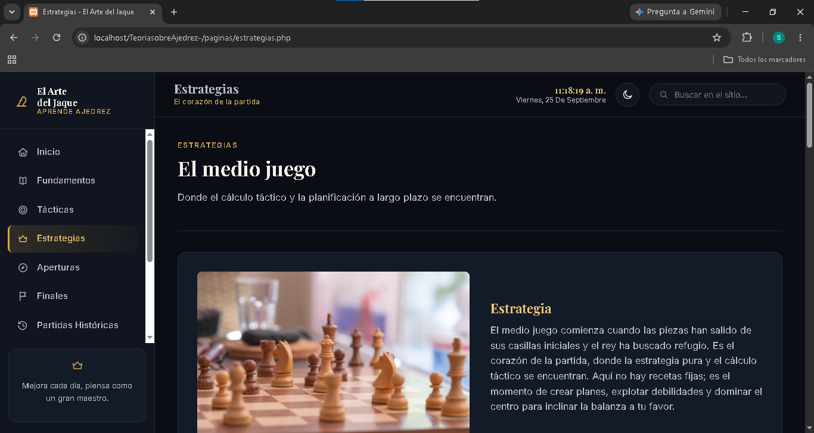
- [x] Contenido de `.env.example`
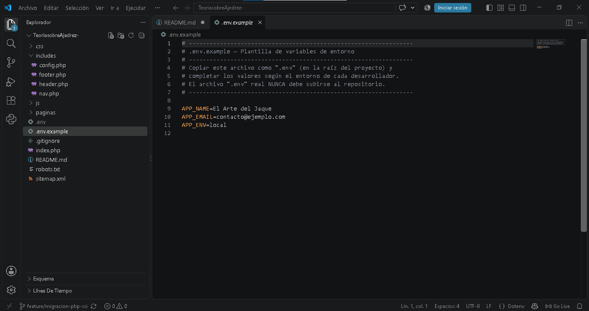

## Checklist de cumplimiento del TP N° 4

### Migración
- [x] Páginas migradas de `.html` a `.php`
- [x] Verificado que funciona mediante servidor local (XAMPP/Laragon)

### Modularización
- [x] `includes/header.php`
- [x] `includes/nav.php`
- [x] `includes/footer.php`
- [x] No se repite código de header/nav/footer entre páginas
- [x] Todas las páginas utilizan las plantillas comunes

### SSR
- [x] `$titulo_pagina` definido en cada página
- [x] `<title>` dinámico en `header.php`
- [x] Menú con clase `active` calculada dinámicamente (`$pagina_actual` + `nav_activo()`)

### Configuración
- [x] `.env`
- [x] `.env.example`
- [x] `.gitignore`
- [x] `.env` excluido de Git

### Documentación
- [x] README con instalación, ejecución local y tecnologías
- [x] Enlace al prototipo de Figma
- [x] Sección de evidencias lista para completar

### Integridad
- [x] CSS enlazado correctamente desde raíz y desde `/paginas`
- [x] JavaScript (`main.js`) enlazado correctamente desde ambos niveles
- [x] Imágenes y rutas verificadas correctamente
- [x] Enlaces internos entre páginas actualizados a `.php`
- [x] Diseño, contenido y estructura visual original conservados
- [x] Contenido original del sitio conservado

## Registro de cambios

Mejoras realizadas después de la entrega del TP de la Clase 5. Cada fase se
trabaja en su propia rama y se integra a `main` mediante un Pull Request.

### Fase 1 — Correcciones visuales (rama `fix/fase1-correcciones-visuales`)

**Componente roto ("carrusel")**
- Los bloques *Movimiento* y *Peón* (Fundamentos), *La Batería* (Estrategias),
  *El Rey como atacante* (Finales) y *Apertura Italiana* (Aperturas) usaban un
  carrusel con flechas que no funcionaban: la grilla CSS tenía 3 columnas para 4
  elementos, por lo que la imagen se veía diminuta o no aparecía. Se
  reemplazaron por el bloque imagen + texto que ya usaba el resto del sitio.
- Se eliminaron del CSS las reglas `.carousel-block`, que quedaron sin uso.

**Tarjetas con la mitad vacía**
- "Táctica vs. Estrategia" (Tácticas) y "Estrategia vs. Táctica" (Estrategias)
  usaban un bloque de dos columnas sin imagen. Ahora usan el panel de ancho
  completo (`simple-panel`).

**Textos incorrectos o desactualizados**
- Ejercicios: se eliminó la mención a una "IA" o "bot" que el sitio no tiene.
  El bloque ahora explica cómo funcionan los ejercicios, ya no repite el
  subtítulo y su título lleva tilde.
- Sobre el sitio: se quitó la referencia al "bot" y se agregó **PHP** a
  "Tecnologías utilizadas", en una grilla de 4 columnas (`card-grid--4`).
- Inicio: el destacado de Partidas Históricas decía "Muy pronto…", aunque la
  página ya existe. Ahora describe su contenido.
- Aperturas: la Apertura Italiana tiene el mismo formato que las demás
  aperturas, y se corrigió un dato histórico: Gioachino Greco la popularizó a
  comienzos del **siglo XVII**, no del XVI.
- Fundamentos: el texto del *Peón* repetía dos veces "captura en diagonal"; el
  párrafo repetido ahora explica que el peón nunca puede retroceder.

**Archivos modificados:** `index.php`, `paginas/fundamentos.php`,
`paginas/tacticas.php`, `paginas/estrategias.php`, `paginas/aperturas.php`,
`paginas/finales.php`, `paginas/ejercicios.php`, `paginas/sobre-el-sitio.php`,
`css/style.css` y este README.

**Pruebas:** las 12 páginas responden sin errores de PHP. Se revisaron
capturas en escritorio (1366 px) y celular (390 px) de cada página modificada.

### Fase 2 — Coherencia y navegación (rama `feature/fase2-navegacion`)

**Navegación**
- **Contacto en el menú lateral:** antes solo se llegaba desde el footer.
- **Enlaces "← Anterior / Siguiente →"** al final de las 9 secciones de
  contenido, en el orden del menú (Fundamentos → Tácticas → … → Recursos). Se
  generan desde un solo archivo, `includes/paginacion.php`, que incluye
  `footer.php`; para cambiar el orden alcanza con editar su array.
- **Menú en pantallas bajas:** en notebooks de 768 px de alto, Contacto
  quedaba fuera de la vista. En pantallas de hasta 860 px de alto se oculta la
  nota decorativa "Mejora cada día…" y, por debajo de 700 px, los ítems se
  compactan.

**Coherencia del texto**
- Todo el sitio usa **"tú"**. Se cambiaron los textos que estaban en "vos":
  los mensajes de los formularios (en PHP y en JavaScript), el aviso del
  buscador del glosario y el cartel de bienvenida. En `clase5/` solo cambió el
  texto de 4 mensajes; la lógica del TP no se modificó.

**Sobre el sitio**
- Las tarjetas de "¿Qué encontrarás?" ahora son **enlaces** a cada sección,
  con una descripción breve. Se agregó Contacto, así quedan 10 tarjetas en dos
  filas completas.
- Se reemplazó el subtítulo y los dos recuadros finales, que sonaban a la
  conclusión de un ensayo, por "¿Cómo aprovechar el sitio?" (orden de lectura
  recomendado) y "Un proyecto en crecimiento".

**Cartel de bienvenida**
- En escritorio aparece debajo del encabezado, así no tapa el buscador ni el
  botón de tema. En celular aparece abajo, así no tapa el botón ☰ del menú.

**Aperturas:** las 6 aperturas tienen el mismo formato (el de la Italiana se
unificó en la Fase 1).

**Archivos nuevos:** `includes/paginacion.php`.
**Archivos modificados:** `includes/nav.php`, `includes/footer.php`,
`paginas/sobre-el-sitio.php`, `paginas/contacto.php`, `paginas/glosario.php`,
`clase5/procesar_contacto.php`, `clase5/buscar_glosario.php`, `js/main.js`,
`css/style.css` y este README.

**Pruebas:** las 12 páginas responden sin errores de PHP. Se verificó que el
paginador encadene las 9 secciones en orden y no aparezca en Inicio, Sobre el
sitio ni Contacto; que Contacto se marque como activo en el menú; los mensajes
de los formularios en "tú"; y capturas en 1366×768, 1280×650 y en celular.

### Fase 3 — Ordenar el código (rama `refactor/fase3-organizacion`)

Fase de organización interna: **el sitio se ve exactamente igual** que antes.

**Lista única de secciones**
- Nuevo `datos/secciones.php`: un array con todas las secciones (título,
  ícono, descripción y si forman parte del recorrido de aprendizaje).
- A partir de ese array se generan **el menú lateral** (`nav.php` pasó de 12
  bloques repetidos a un `foreach`), **los enlaces Anterior / Siguiente**
  (`paginacion.php`) y **las tarjetas "¿Qué encontrarás?"** de Sobre el sitio.
  Antes la misma información estaba copiada en tres archivos; ahora agregar o
  reordenar una sección es editar un solo lugar.
- Nuevo `includes/secciones.php` con dos funciones: `secciones_del_sitio()`
  (lee el array una sola vez) y `url_seccion()` (arma el enlace correcto desde
  la raíz o desde `/paginas`).

**CSS (`css/style.css`)**
- Se agregó un **índice** al principio del archivo con las 17 secciones.
- El bloque RESPONSIVE estaba en el medio del archivo, con otras secciones
  agregadas después. Ahora es la última sección ("RESPONSIVE GENERAL"). Antes
  de moverlo se verificó con un script que ninguna regla posterior compartía
  selector y propiedad con ese bloque, así que el resultado visual no cambia.

**README:** la estructura de carpetas incluye los archivos nuevos, y las
instrucciones de XAMPP y Laragon usan el nombre real de la carpeta
(`TeoriasobreAjedrez-`).

**Pendiente a propósito:** las funciones de componentes reutilizables (bloque
imagen + texto, tarjeta) se van a crear en las fases 4 a 6, junto con el
contenido que las usa (fichas de aperturas y ejercicios), para no dejar código
sin uso.

**Archivos nuevos:** `datos/secciones.php`, `includes/secciones.php`.
**Archivos modificados:** `includes/nav.php`, `includes/paginacion.php`,
`paginas/sobre-el-sitio.php`, `css/style.css` y este README.

**Pruebas:** se guardó el HTML que generaban las 12 páginas antes de los
cambios y se comparó con el de después: **idéntico** en las 12, sin contar
espacios. El CSS tiene exactamente las mismas reglas, solo cambió el orden y
los comentarios. Revisión visual en escritorio, tablet (1000 px) y celular.

### Fase 4A — Catálogo de aperturas (rama `feature/fase4a-aperturas`)

**De 6 aperturas fijas a un catálogo de 15**
- Las aperturas pasaron del HTML a datos (`datos/aperturas.php`), con una
  **ficha común** para todas: tipo, código ECO, nivel recomendado, jugadas
  iniciales, resumen e historia, idea de las blancas, idea de las negras,
  conceptos que enseña y una sección desplegable (`<details>`) con planes
  típicos, errores comunes y trampas, y jugadores que la usan.
- Se ampliaron las 6 existentes (Italiana, Española, Siciliana, Francesa,
  Caro-Kann y Gambito de Dama) y se agregaron 9:
  - **Abiertas:** Dos Caballos, Escocesa, Gambito de Rey, Petrov y Vienesa.
  - **Semiabiertas:** Escandinava, Pirc, Alekhine y Moderna.
- Las trampas incluyen la secuencia completa de jugadas: Blackburne-Shilling,
  "Hígado frito", Elefante, el mate de Cd6 en la Caro-Kann, el jaque
  descubierto en la Petrov y la pérdida de dama en la Escocesa.
- Se corrigió la fecha de Greco (siglo XVII) y se sumaron 3 principios de
  apertura: *Vigila f7 y f2*, *Caballos antes que alfiles* e *Ideas antes que
  jugadas*.

**Filtro por tipo (método GET)**
- `aperturas.php?tipo=abierta|semiabierta|cerrada`, con el mismo tratamiento
  de seguridad que el buscador del glosario:
  - captura con `filter_input()` y `FILTER_REQUIRE_SCALAR` (rechaza arrays);
  - `trim()` con `limpiar()`;
  - validación contra una **lista blanca** (`datos/tipos-apertura.php`);
  - salida con `e()`.
- Un valor inválido muestra un aviso y todas las aperturas.
- Solo se ofrecen los tipos que ya tienen aperturas cargadas. Indias y de
  flanco se suman en la Fase 4B.

**Componentes reutilizables (tarea 3.3)**
- Nuevo `includes/componentes.php` con `ficha_apertura()` y `lista_jugadas()`.
  Imprimen el HTML a partir de los datos y escapan todo con el `e()` de la
  Clase 5.

**Archivos nuevos:** `datos/aperturas.php`, `datos/tipos-apertura.php`,
`includes/componentes.php`.
**Archivos modificados:** `paginas/aperturas.php`, `datos/secciones.php`
(descripción de Aperturas), `css/style.css` (nueva sección "Catálogo de
aperturas") y este README.

**Pruebas:** la página carga sin errores de PHP y muestra 15 fichas en 3
grupos. El filtro devuelve 7 aperturas abiertas, 7 semiabiertas y 1 cerrada.
Se probaron un tipo inexistente, uno todavía sin aperturas, un valor con
espacios, un array (`?tipo[]=`) y un intento de XSS (`<script>`): todos se
rechazan o se corrigen sin errores. Capturas en escritorio y celular.

### Fase 4B — Catálogo completo y trampas de apertura (rama `feature/fase4b-aperturas`)

**13 aperturas nuevas (de 15 a 28)**
- **Cerradas:** Eslava, Sistema Londres, Sistema Colle y Catalana.
- **Indias y otras defensas contra 1.d4:** India de Rey, Nimzoindia, India de
  Dama, Grünfeld, Benoni Moderna y Holandesa.
- **De flanco:** Inglesa, Réti y Bird.
- Cada una tiene la ficha completa de la Fase 4A, con datos históricos que
  conectan con otras secciones. Por ejemplo, la "Partida del Siglo" de Fischer
  (1956) empezó con una Grünfeld, y Fischer jugó la Inglesa en el Mundial
  de 1972.
- El filtro GET suma los tipos `india` y `flanco`; el catálogo queda con 5
  grupos: 7 abiertas, 7 semiabiertas, 5 cerradas, 6 indias y 3 de flanco.

**Nueva sección: Trampas de apertura**
- Nuevo `datos/trampas.php` con 8 trampas clásicas: Mate del Loco, Mate del
  Pastor, Mate de Légal, Blackburne-Shilling, Trampa de la Petrov, Mate en la
  Caro-Kann, Trampa del Elefante y Gambito From.
- Cada tarjeta muestra la secuencia completa, por qué funciona y la lección
  (cómo evitarla). Si la trampa pertenece a una apertura del catálogo, enlaza
  a su ficha (`aperturas.php#italiana`).
- Nueva función `tarjeta_trampa()` en `includes/componentes.php`.

**Revisión de exactitud:** se verificó casilla por casilla cada secuencia de
mate (Légal, Blackburne-Shilling, Caro-Kann, Gambito From y Pastor) y los
rangos ECO. Se usa el término "mate de la coz", y no "mate ahogado", para no
confundirlo con el ahogado (tablas) del glosario.

**Archivos nuevos:** `datos/trampas.php`.
**Archivos modificados:** `datos/aperturas.php`, `datos/tipos-apertura.php`,
`includes/componentes.php`, `paginas/aperturas.php`, `css/style.css` y este
README.

**Pruebas:** la página carga sin errores de PHP y muestra 28 fichas en 5
grupos y 8 trampas. Cada filtro devuelve la cantidad esperada, los 6 enlaces
de las trampas apuntan a fichas que existen y un intento de XSS en `?tipo=` se
rechaza. El resto del sitio sigue respondiendo bien.

### Fase 5 — Ampliar el contenido (rama `feature/fase5-contenido`)

Cada sección ampliada se guarda en un commit propio dentro de la rama.

**5.1 Tácticas: ejemplos concretos**
- Cada una de las 11 tácticas tiene un desplegable **"Ver ejemplo"** con una
  situación concreta (casillas y jugadas). Ejemplo: la horquilla Cc7+ contra
  el rey de e8 y la torre de a8. Las geometrías se verificaron una por una
  (diagonales libres, saltos de caballo, filas abiertas).
- Nueva táctica número 12: **Jugada intermedia**, con el ejemplo de la Trampa
  del Elefante (7...Ab4+). Ahora son 12 tarjetas en 4 filas completas.
- Los ejemplos enlazan a otras secciones: el jaque descubierto, a la trampa de
  la Petrov; el sacrificio, a la Partida Inmortal.

**5.2 Patrones de mate (nueva sección en Tácticas)**
- Seis patrones con su descripción y una nota sobre cómo reconocerlos o
  evitarlos: pasillo, coz, Anastasia, Boden, beso y escalera.

**5.3 Finales**
- Nueva sección **"Mates básicos paso a paso"** (`finales.php#mates-basicos`):
  rey y dama contra rey (con la advertencia del ahogado), rey y torre contra
  rey (método de la caja y la oposición) y dos torres contra rey (mate de la
  escalera), con instrucciones numeradas.
- Nueva sección **"Finales teóricos"**: la posición de Lucena (cómo ganar
  "construyendo un puente") y la de Philidor (cómo defender con la torre en la
  tercera fila y después jaques desde atrás).
- Dos conceptos nuevos: **Triangulación** y **Fortaleza** (10 tarjetas en
  dos filas completas). La tarjeta "Conceptos básicos de mate" enlaza a la
  explicación paso a paso.

**5.4 Estrategias**
- Tres conceptos nuevos: **Puesto avanzado**, **Profilaxis** y **Cuándo
  cambiar piezas** (15 tarjetas en tres filas completas).
- Nueva sección **"Estructuras de peones"**: peón aislado, peones doblados,
  peón retrasado, peones colgantes, cadena de peones y mayoría de peones, cada
  una con su ventaja y su desventaja.
- Nueva sección **"Piezas buenas y piezas malas"**: alfil bueno y alfil malo, y
  caballo contra alfil.

**5.5 Fundamentos**
- **Captura al paso** explicada con un ejemplo (faltaba en el sitio).
- Secciones nuevas: **Notación algebraica** (cómo se anotan las jugadas en
  todo el sitio), **Ritmos de juego y reloj** (bala, blitz, rápidas, clásicas e
  incremento), **La puntuación ELO** (con valores de referencia) y **Reglas de
  torneo** (pieza tocada, "compongo", jugadas ilegales, ofrecer tablas, una
  sola mano y teléfono celular), según las Leyes del Ajedrez de la FIDE.

**5.6 Partidas Históricas**
- Cada partida tiene un **"Momento clave"** con las jugadas decisivas, por
  ejemplo 18.Ad6!! en la Inmortal y 24.Txd4!! en Kasparov vs. Topalov.
- La Inmortal y la de la Ópera incluyen la **partida completa** en un
  desplegable. Las partidas enlazan a su apertura y a la explicación de la
  notación.

**5.7 Glosario**
- De **38 a 63 términos**: Blitz, Bloqueo, Calidad, ELO, Fianchetto,
  Fortaleza, Gran Maestro, Hipermoderno, Iniciativa, Jaque perpetuo, Jugada
  intermedia, Mate del pasillo, Peón aislado, Peones doblados, Pieza mayor,
  Pieza menor, Profilaxis, Puesto avanzado, Rayos X, Regla de los 50
  movimientos, Repetición de jugadas, Ruptura, Tempo, Triangulación y Variante.
- Se agregaron a `clase5/datos/glosario.php` con un script que conserva el
  orden alfabético. Es solo contenido: el buscador GET del TP los incluye sin
  ningún cambio en su lógica.

**5.8 Recursos**
- Dos libros nuevos: *Fundamentos del Ajedrez* (Capablanca) y *Mis 60
  Partidas Memorables* (Fischer). Son 6 en total, en dos filas completas.
- Nueva sección **"Entrenar gratis"**: estudios, práctica y entrenador de
  coordenadas de Lichess. Se verificó que los 11 enlaces externos de la página
  respondan correctamente.

**Archivos modificados en la Fase 5:** `paginas/tacticas.php`,
`paginas/finales.php`, `paginas/estrategias.php`, `paginas/fundamentos.php`,
`paginas/partidas.php`, `paginas/recursos.php`, `paginas/glosario.php` (meta
descripción), `clase5/datos/glosario.php` (términos nuevos), `css/style.css`
y este README.

**Pruebas:** las 12 páginas responden sin errores de PHP. El buscador del
glosario encuentra los términos nuevos y sigue rechazando el XSS, el
formulario de contacto valida igual que antes y el filtro de aperturas
funciona. Todos los enlaces internos con ancla (`#mates-basicos`,
`#notacion`, `#trampas`, `#reglas`) llevan a secciones que existen. Capturas
de Tácticas, Finales, Fundamentos y Partidas.

### Fase 6 — Ejercicios interactivos (rama `feature/fase6-ejercicios`)

**De 8 a 20 ejercicios, con datos separados**
- Los ejercicios pasaron a `datos/ejercicios.php`: 5 por tema
  (fundamentos, tácticas, estrategia y finales), cada uno con su nivel.
- Se corrigieron los ejercicios anteriores: los dos que tenían más de una
  respuesta correcta ahora lo avisan ("Hay 2 respuestas correctas"), el que
  preguntaba al revés ("¿qué deberías evitar?") se reemplazó, y el primero de
  tácticas, que era demasiado obvio, se cambió por una horquilla real.

**Interactivos**
- Las opciones son botones: al hacer clic se marcan en **verde** (correcta)
  o en **rojo** (incorrecta), con un mensaje. Al encontrar todas las correctas,
  el ejercicio se bloquea y se abre la explicación (`initEjercicios()` en
  `js/main.js`).
- La explicación está en un `<details>`, así que también se puede leer con
  JavaScript desactivado.
- Se agregaron los colores `--success` y `--success-bg`, con su versión para
  el modo claro.

**Diagramas de tablero**
- Nueva función `tablero()` en `includes/componentes.php`: dibuja el tablero
  con HTML/CSS a partir de una posición en formato FEN, con coordenadas y
  piezas Unicode. Para lectores de pantalla genera una descripción en texto
  ("Blancas: Ce4. Negras: …").
- 10 ejercicios tienen diagrama: horquilla, mate del pasillo, Mate del Pastor,
  jaque descubierto de la Petrov, mate de la coz en dos jugadas, captura al
  paso, ahogado, mate con dama y regla del cuadrado.

**Verificación de las posiciones:** un script de prueba calcula las casillas
atacadas y confirmó cada mate y cada ahogado de los enunciados. Encontró un
error que se corrigió antes de publicar: en un ejercicio de finales, la
jugada que debía ser ahogado no lo era, porque el rey blanco tapaba la
columna.

**Pruebas:** la página genera 20 ejercicios, 10 diagramas y 22 respuestas
correctas, sin errores de PHP. Con Chrome controlado por su protocolo de
depuración se simularon clics reales: una opción incorrecta se marca en rojo;
la primera de dos correctas avisa que falta otra; al completar, el ejercicio
se bloquea y se abre la solución; los demás ejercicios no se ven afectados.
Las capturas de primer plano detectaron filas de distinta altura en el
tablero, que se corrigieron.

### Fase 7 — Plan de estudio y ajustes finales (rama `feature/fase7-plan-de-estudio`)

Fase reducida a propósito: solo cambios que siguen lo que el proyecto ya hace
(páginas con la misma plantilla, datos en arrays y clases CSS existentes).

**Plan de Estudio (nueva página `paginas/plan-de-estudio.php`)**
- Ordena en tres niveles (principiante, intermedio y avanzado) las secciones
  que ya existen. **No agrega contenido nuevo**: cada paso enlaza
  directamente a la parte del sitio donde se explica (por ejemplo
  `fundamentos.php#notacion` o `aperturas.php?tipo=india#catalogo`).
- Se agregó al menú lateral con una sola entrada en `datos/secciones.php`, y
  se enlaza desde "¿Cómo aprovechar el sitio?" en Sobre el sitio.

**Recursos:** las secciones con 2 tarjetas (Jugar, Practicar, Estudiar y
Analizar partidas) usan la nueva variante `card-grid--2` y ya no dejan un
hueco por fila. Tiene sus reglas responsive para que la grilla general no la
pise en pantallas medianas.

**`sitemap.xml`:** se sumó la página nueva (13 URLs, XML válido).

**Descartado de esta fase y por qué:** la página de historia y campeones
(sería contenido nuevo), las imágenes locales (alojar imágenes en el
repositorio es algo que el proyecto nunca hizo y suma varios MB), la página
404 (requiere configurar Apache con `.htaccess`) y el botón "volver arriba"
(una funcionalidad nueva).

**Pruebas:** las 13 páginas responden sin errores de PHP. Se verificó con un
script que los 22 enlaces del plan llevan a páginas y anclas que existen.
El menú (13 ítems) entra completo en una pantalla de 1366×768, el plan no
muestra el paginador, "Sobre el sitio" conserva sus 10 tarjetas y el sitemap
es XML válido.

## Créditos

Sitio educativo creado por **Samuel**.
