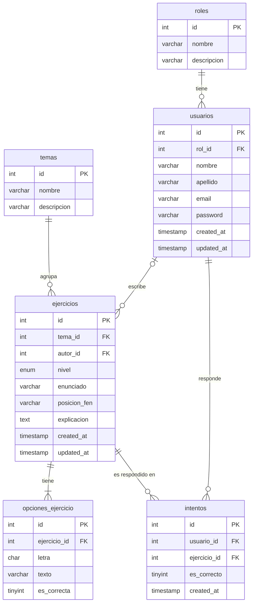

# TP6 — Normalización: El Arte del Jaque

El sitio tiene una página de **Ejercicios**: cada ejercicio pertenece a un tema
(fundamentos, tácticas, estrategia o finales), tiene un nivel, un enunciado,
varias opciones de respuesta y una explicación, y lo escribe un usuario
administrador. Hoy esos datos están en un archivo PHP; en este TP se diseña la
base de datos que los va a guardar.

## 1. Tabla sin normalizar

Un registro hipotético de ejercicios, tal como se anotaría "en una planilla":

| ejercicio | nivel | enunciado | tema | tema_descripcion | autor | autor_email | autor_rol | opciones |
|---|---|---|---|---|---|---|---|---|
| 1 | Principiante | ¿Cuántos peones vale una torre? | Fundamentos | Reglas básicas y movimiento de las piezas | Samuel Guaimas | admin@arte-del-jaque.com | administrador | A) 1 · B) 3 · C) 5 ✔ · D) 9 |
| 2 | Principiante | ¿Qué jugada gana material? | Tácticas | Golpes tácticos: horquillas, clavadas, mates | Samuel Guaimas | admin@arte-del-jaque.com | administrador | A) Cc7+ ✔ · B) Cf6+ · C) Ce7 |

**Problemas:**
- **Campo multivalorado:** `opciones` guarda varias respuestas (y cuál es la
  correcta) en una sola celda.
- **Información redundante:** el nombre, el email y el rol del autor, y la
  descripción del tema, se repiten en cada ejercicio. Si el autor cambia su
  email, habría que corregirlo en todas las filas.

## 2. Proceso de normalización

### Primera Forma Normal (1FN)

**Por qué:** cada campo debe tener un solo valor (atómico). Se elimina la lista
de opciones: cada opción pasa a ser una fila, con su letra, su texto y si es
correcta. La clave pasa a ser compuesta: **(ejercicio, letra)**.

| ejercicio (PK) | letra (PK) | texto | es_correcta | nivel | enunciado | tema | tema_descripcion | autor | autor_email | autor_rol |
|---|---|---|---|---|---|---|---|---|---|---|
| 1 | A | 1 | 0 | Principiante | ¿Cuántos peones vale una torre? | Fundamentos | Reglas básicas… | Samuel Guaimas | admin@… | administrador |
| 1 | B | 3 | 0 | Principiante | ¿Cuántos peones vale una torre? | Fundamentos | Reglas básicas… | Samuel Guaimas | admin@… | administrador |
| 1 | C | 5 | 1 | Principiante | ¿Cuántos peones vale una torre? | Fundamentos | Reglas básicas… | Samuel Guaimas | admin@… | administrador |
| 1 | D | 9 | 0 | Principiante | ¿Cuántos peones vale una torre? | Fundamentos | Reglas básicas… | Samuel Guaimas | admin@… | administrador |
| 2 | A | Cc7+ | 1 | Principiante | ¿Qué jugada gana material? | Tácticas | Golpes tácticos… | Samuel Guaimas | admin@… | administrador |

Ahora todos los campos son atómicos, pero la redundancia aumentó: el enunciado
se repite en cada opción.

### Segunda Forma Normal (2FN)

**Por qué:** cada columna que no es clave debe depender de **toda** la clave
primaria. Con la clave (ejercicio, letra):

- `texto` y `es_correcta` dependen de **(ejercicio, letra)**: dependencia
  completa.
- `nivel`, `enunciado`, `tema`, `tema_descripcion`, `autor`, `autor_email` y
  `autor_rol` dependen **solo de ejercicio**: dependencia parcial.

Se separan en dos tablas:

**ejercicios** (PK: ejercicio)

| ejercicio | nivel | enunciado | tema | tema_descripcion | autor | autor_email | autor_rol |
|---|---|---|---|---|---|---|---|
| 1 | Principiante | ¿Cuántos peones vale una torre? | Fundamentos | Reglas básicas… | Samuel Guaimas | admin@… | administrador |
| 2 | Principiante | ¿Qué jugada gana material? | Tácticas | Golpes tácticos… | Samuel Guaimas | admin@… | administrador |

**opciones_ejercicio** (PK: ejercicio + letra)

| ejercicio | letra | texto | es_correcta |
|---|---|---|---|
| 1 | A | 1 | 0 |
| 1 | C | 5 | 1 |
| 2 | A | Cc7+ | 1 |

### Tercera Forma Normal (3FN)

**Por qué:** ninguna columna no clave debe depender de otra columna no clave
(dependencia transitiva). En `ejercicios` hay dos:

- `ejercicio → tema → tema_descripcion`: la descripción depende del tema, no
  del ejercicio. Se crea la tabla **temas** y `ejercicios` guarda solo `tema_id`.
- `ejercicio → autor_email → autor, autor_rol`: los datos del autor dependen
  del autor. Se crea la tabla **usuarios** y `ejercicios` guarda `autor_id`.
  A su vez, `usuario → rol → descripción del rol`: el rol se lleva a la tabla
  **roles** y `usuarios` guarda `rol_id`.

**temas**

| id | nombre | descripcion |
|---|---|---|
| 1 | Fundamentos | Reglas básicas y movimiento de las piezas |
| 2 | Tácticas | Golpes tácticos: horquillas, clavadas, mates |

**roles**

| id | nombre | descripcion |
|---|---|---|
| 1 | administrador | Puede cargar y editar ejercicios |
| 2 | estudiante | Resuelve los ejercicios del sitio |

**usuarios**

| id | rol_id | nombre | apellido | email |
|---|---|---|---|---|
| 1 | 1 | Samuel | Guaimas | admin@arte-del-jaque.com |

**ejercicios**

| id | tema_id | autor_id | nivel | enunciado |
|---|---|---|---|---|
| 1 | 1 | 1 | Principiante | ¿Cuántos peones vale una torre? |
| 2 | 2 | 1 | Principiante | ¿Qué jugada gana material? |

**opciones_ejercicio**: sin cambios respecto de 2FN.

> **Nota sobre `nivel`:** se deja como columna de `ejercicios` (con valores
> fijos `ENUM`) porque no tiene datos propios que dependan de él. Si en el
> futuro cada nivel tuviera, por ejemplo, una descripción, se llevaría a una
> tabla `niveles`.

### Segundo registro: los ejercicios que resolvió cada usuario (relación N:M)

El sitio también tiene que guardar qué ejercicios respondió cada usuario y si
acertó. Anotado sin normalizar, aparece otra lista en una sola celda:

| usuario | email | rol | ejercicios_respondidos |
|---|---|---|---|
| Ana García | ana.garcia@correo.com | estudiante | 1 ✔ · 2 ✘ · 2 ✔ |
| Samuel Guaimas | admin@arte-del-jaque.com | administrador | 3 ✔ |

- **1FN:** la lista se separa en una fila por intento (usuario, ejercicio,
  resultado, fecha). Ahora los datos del usuario se repiten en cada intento.
- **2FN:** el nombre, el email y el rol dependen solo del usuario, no del
  intento. Quedan en la tabla `usuarios` (con su rol en `roles`, como ya se vio).
- **3FN:** cada intento guarda únicamente `usuario_id`, `ejercicio_id`, si
  acertó y la fecha.

El resultado es la tabla **intentos**, que relaciona usuarios y ejercicios.
Es una relación **muchos a muchos (N:M)**: un usuario responde muchos
ejercicios y un ejercicio es respondido por muchos usuarios.

**intentos**

| id | usuario_id | ejercicio_id | es_correcto |
|---|---|---|---|
| 1 | 2 | 1 | 1 |
| 2 | 2 | 2 | 0 |
| 3 | 2 | 2 | 1 |
| 4 | 1 | 3 | 1 |

## 3. Tablas resultantes

En el `schema.sql`, todas las tablas usan una clave primaria
`id INT AUTO_INCREMENT`. En `opciones_ejercicio`, la clave natural
(ejercicio + letra) se mantiene como restricción `UNIQUE`.

| Tabla | Columnas | PK | FK |
|---|---|---|---|
| **roles** | id, nombre, descripcion | id | — |
| **temas** | id, nombre, descripcion | id | — |
| **usuarios** | id, rol_id, nombre, apellido, email, password, created_at, updated_at | id | rol_id → roles.id |
| **ejercicios** | id, tema_id, autor_id, nivel, enunciado, posicion_fen, explicacion, created_at, updated_at | id | tema_id → temas.id · autor_id → usuarios.id |
| **opciones_ejercicio** | id, ejercicio_id, letra, texto, es_correcta | id | ejercicio_id → ejercicios.id |
| **intentos** (N:M) | id, usuario_id, ejercicio_id, es_correcto, created_at | id | usuario_id → usuarios.id · ejercicio_id → ejercicios.id |

Restricciones únicas: `roles.nombre`, `temas.nombre`, `usuarios.email` y
`opciones_ejercicio (ejercicio_id, letra)`. En `intentos` no hay restricción
única porque un usuario puede intentar el mismo ejercicio más de una vez.

### Diagrama entidad-relación

